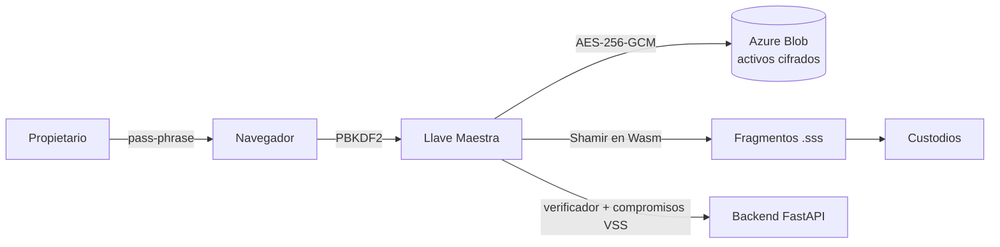

# TT-B152 · Prototipo de aplicación web para la preservación y transferencia del patrimonio digital


**Trabajo Terminal · Escuela Superior de Cómputo (ESCOM), Instituto Politécnico Nacional.**

TT-B152 es un prototipo de aplicación web para resguardar activos digitales sensibles y facilitar su transferencia tras el fallecimiento o la incapacidad del propietario, bajo un modelo estricto de seguridad **Zero-Knowledge**: el servidor nunca tiene acceso a los secretos ni al contenido de las bóvedas.

## Tabla de contenido

- [La solución: arquitectura Zero-Knowledge](#la-solución-arquitectura-zero-knowledge)
- [Stack tecnológico](#stack-tecnológico)
- [Puesta en marcha](#puesta-en-marcha-desarrollo-local)
- [PayPal (cambios de plan)](#paypal-cambios-de-plan-de-pago)
- [Equipo](#equipo)
- [Licencia](#licencia)

---

## La solución: arquitectura Zero-Knowledge

TT-B152 separa la autenticación tradicional del cifrado de los activos:

1. **Cifrado local.** Los activos se cifran en el navegador (AES-256-GCM) antes de transmitirse. La subida es directa del navegador al Blob mediante un token temporal (SAS); el backend nunca ve el contenido.
2. **Llave por bóveda (pass-phrase → DEK).** Cada bóveda tiene una *pass-phrase* de alta entropía que solo conoce el propietario. En el navegador, `PBKDF2-SHA-256` (600 000 iteraciones) deriva de ella la Llave Maestra AES-256, que nunca abandona la RAM del cliente. El servidor solo guarda un **verificador** (hash) y los parámetros no secretos del KDF (`salt`, iteraciones).
3. **Motor criptográfico en Wasm.** Desarrollado en **C y compilado a WebAssembly**, fragmenta la Llave Maestra en el navegador con **Shamir Secret Sharing**. Los fragmentos (`.sss`) se distribuyen manualmente a una red de *custodios*.
4. **Verifiable Secret Sharing (Feldman VSS).** El servidor solo almacena los compromisos públicos de la Llave Maestra, lo que permite validar la autenticidad de los fragmentos aportados durante la recuperación **sin conocer el secreto**.
5. **Interruptor de Hombre Muerto.** Un protocolo automatizado de pruebas de vida: si el propietario deja de responder, la bóveda pasa a estado de recuperación.



---

## Stack tecnológico

| Capa | Tecnología | Propósito |
| :--- | :--- | :--- |
| **Criptografía (core)** | `C` → `WebAssembly` | Aritmética modular (campos de Galois), fragmentación y reconstrucción polinomial con rendimiento casi nativo en el navegador. |
| **Backend** | `FastAPI` (Python) | Orquestación del protocolo de Hombre Muerto, validación de estado y API RESTful. |
| **Base de datos** | `MariaDB` | Persistencia ACID de metadatos (usuarios, bóvedas, custodios, compromisos VSS, activos). |
| **Almacenamiento** | `Azure Blob Storage` · `Azurite` en local | Resguardo de activos cifrados; subida y descarga directas por SAS. |
| **Frontend** | `React` + `Vite` | Gestión de bóvedas y portal de recuperación. |
| **Notificaciones** | SMTP (`Mailpit` en local) · `Telegram Bot` | Verificación de canales de contacto de los custodios y avisos del protocolo de vida, desde una cola con reintentos. |
| **Infraestructura** | `Docker` / `Docker Compose` | Entorno de desarrollo aislado y reproducible. |

---

## Puesta en marcha (desarrollo local)

**Requisitos:** Docker y Docker Compose.

```bash
git clone <url-del-repo>
cd <nombre-de-directorio>
cp .env.example .env        # ajusta credenciales, SECRET_KEY y la cadena de Azurite
docker compose up --build
```

| Servicio | URL | Notas |
| :--- | :--- | :--- |
| Frontend | `http://localhost:5173` | React + Vite con recarga en caliente. |
| Backend | `http://localhost:8000` | FastAPI; documentación interactiva en `/docs`. |
| MariaDB | `localhost:3306` | Credenciales según `.env`. |
| Azurite | `localhost:10000` | Emulador de Azure Blob Storage. |
| Mailpit | `http://localhost:8025` | UI para revisar el correo saliente (SMTP en `localhost:1025`; no entrega correos reales). |

### Variables de entorno

Se configuran en `.env` (plantilla en `.env.example`).

| Variable | Obligatoria | Descripción |
| :--- | :---: | :--- |
| `DB_*` / `DATABASE_URL` | Sí | Conexión a MariaDB. |
| `SECRET_KEY` | Sí | Clave secreta del backend. |
| `AZURE_STORAGE_CONNECTION_STRING` | Sí | Cadena de conexión a Azurite o Azure Blob Storage. |
| `SMTP_*` | No | Correo saliente; por defecto apunta al Mailpit de `docker compose up`. |
| `TELEGRAM_*` | No | Bot de Telegram para verificar canales de los custodios. |
| `PAYPAL_*` | No | Credenciales de PayPal Sandbox (ver abajo). |

### PayPal (cambios de plan de pago)

La vista de **Suscripción** ejecuta el flujo real de PayPal (Orders v2: crear orden → aprobación del comprador → *capture*) cuando hay credenciales; sin ellas, ofrece "simular pago".

1. En [developer.paypal.com](https://developer.paypal.com/dashboard/applications/sandbox) crea una app **REST** en modo *Sandbox* y copia su **Client ID** y **Secret**.
2. En `.env` define:
   ```env
   PAYPAL_CLIENT_ID=...
   PAYPAL_CLIENT_SECRET=...
   PAYPAL_CURRENCY=USD   # la moneda de tu cuenta sandbox
   ```
3. Recarga las variables: `docker compose up -d backend`.
4. Paga en la vista con una cuenta **compradora de sandbox** (Dashboard → Sandbox → Accounts).

> **Seguridad:** el backend nunca confía en el importe ni en el plan que envía el navegador. Lee el plan del `reference_id` de la orden y hace el *capture* contra la API de PayPal antes de aplicar el cambio.

---

## Equipo

**Integrantes**

| Nombre | Rol | Contacto |
| :--- | :--- | :--- |
| Yair Alejandro Erreguin Franco | Developer | [GitHub](https://github.com/yaeef) |
| Johnny Hernández Torres | Developer | [GitHub](https://github.com/Johnny117sone) |

**Directores**

- Dr. Manuel Alejandro Cardona López
- Dr. Benjamín Luna Benoso

**Institución:** Escuela Superior de Cómputo (ESCOM), Instituto Politécnico Nacional, Ciudad de México.

## Licencia y propiedad intelectual

Este trabajo fue desarrollado como Trabajo Terminal en la Escuela Superior de Cómputo (ESCOM) y su propiedad corresponde al **Instituto Politécnico Nacional (IPN)**.

Este repositorio se publica con fines académicos y de consulta. No se concede licencia de uso, copia, modificación ni distribución sin autorización expresa del IPN.

**Autores:** Yair Alejandro Erreguin Franco y Johnny Hernández Torres.

> ⚠️ **Aviso:** TT-B152 es un prototipo académico. No ha sido auditado y no debe usarse para resguardar información crítica en producción sin una revisión de seguridad independiente.